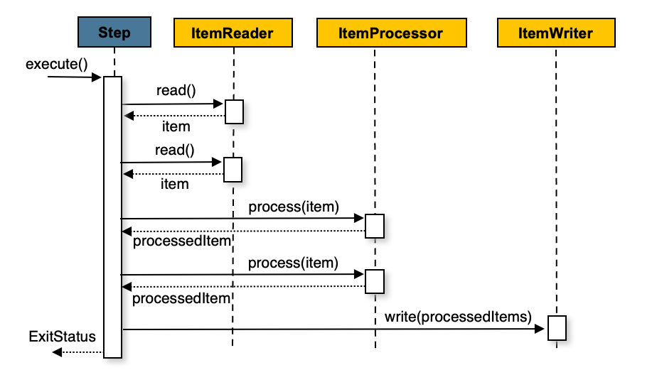

# 개발 프레임워크

## 주요 Software Stack

- Java 21
- Spring 6.2.9
- Spring Boot 3.5.4
- Spring Batch 5.2.2
- MyBatis 3.0.4
- Maven 3.9.6
- Apache Commons
- Cache: Ehcache

### 지원하지 않는 요소
- h2
- jpa

## 기본 패키지 (예시)

```text
kr.co.wlife.fac.batch.smp.dd
```

## Spring Batch 개요

- Spring Batch는 대량 데이터 처리를 위한 배치 프레임워크. 개발자는 **Job, Step, Reader/Processor/Writer 또는 Tasklet**을 정의
- Job 실행 및 실행 이력 관리 같은 공통 인프라는 Spring Boot가 자동 구성.

## Spring Batch 용어

| 용어 | 설명 |
|---|---|
| Job | 배치 처리의 전체 단위. 하나 이상의 Step으로 구성됨. |
| JobInstance | 동일한 Job을 특정 식별 조건으로 실행한 논리적 실행 단위. |
| JobExecution | JobInstance의 실제 실행 기록. 시작/종료 시간, 상태, 예외 정보를 포함. |
| JobParameters | Job 실행 시 전달하는 파라미터. 예: 처리 대상일자, 파일 경로 |
| Step | Job을 구성하는 독립 처리 단위. Chunk 방식 또는 Tasklet 방식으로 구현. |
| StepExecution | Step의 실제 실행 기록. Read/Write/Skip/Commit/Rollback 건수를 관리. |
| ItemReader | 데이터를 한 건 씩 읽는 컴포넌트. chunk-size(예: 100)만큼 반복 read()  → 1건 (×100번)|
| ItemProcessor | 읽은 데이터를 검증·변환·가공하는 컴포넌트. process() → 1건씩 변환. 필수 요소 아님. 사용하지 않아도 됨|
| ItemWriter | 가공된 데이터를 DB, 파일 등 대상에 저장하는 컴포넌트. chunk 단위로 묶어서 쓰기|
| Chunk | Reader가 읽고 Processor가 처리한 일정 건수를 Writer로 한 번에 저장하는 처리 단위. |
| Tasklet | Step 하나를 단일 작업으로 처리하는 컴포넌트. |
| JobRepository | Job/Step 실행 이력을 DB에 저장·관리하는 컴포넌트. |
| JobLauncher | Job을 실행하는 컴포넌트. |
| JobExplorer | 저장된 Job 실행 이력을 조회하는 컴포넌트. |
| ExecutionContext | Step 또는 Job 실행 중 공유하는 key-value 데이터 저장소. |
| Partition | 전체 데이터를 여러 구간으로 나누어 병렬 처리하는 기법. |

## Step 처리 방식

Step은 처리 방식에 따라 **Chunk 방식**과 **Tasklet 방식**으로 나눔. 대량 데이터 병렬 처리가 필요하면 **Partition**을 추가로 적용.

### Chunk 방식

대량 데이터를 일정 건수(Chunk Size) 단위로 읽고, 가공한 뒤 저장하는 방식. Chunk 단위로 트랜잭션이 커밋되므로 장애 발생 시 마지막 커밋 지점부터 재시작할 수 있음.

| 구분 | 설명 |
|---|---|
| 구성 | `ItemReader` → `ItemProcessor` → `ItemWriter` |
| 처리 단위 | Chunk Size 단위 |
| 트랜잭션 | Chunk 단위 커밋 |
| 실행 방식 | 기본적으로 단일 스레드 |
| 건수 집계 | Read/Write 건수 자동 집계 |
| 적합한 작업 | 대량 데이터를 건별로 조회·가공·적재하는 작업 |




### Tasklet 방식

Step 전체를 하나의 작업으로 처리하는 방식. 주로 단일 SQL 실행, 파일 이동, 디렉터리 생성, 집계 처리처럼 반복적인 Item 처리가 필요 없는 경우에 사용.

| 구분 | 설명 |
|---|---|
| 구성 | `Tasklet` 하나 |
| 처리 단위 | Step 전체 |
| 트랜잭션 | 기본적으로 Step 전체가 하나의 트랜잭션 |
| 실행 방식 | 단일 스레드 |
| 건수 집계 | 직접 처리 건수를 반영해야 함 |
| 적합한 작업 | `INSERT ... SELECT`, `DELETE`, 집계, 파일 처리 등 단일 작업 |

> Tasklet에는 Writer가 없으므로 Write Count가 자동 증가하지 않음. 처리 건수를 실행 이력에 반영하려면 `StepContribution.incrementWriteCount(처리건수)`를 호출해야 함.

### Chunk와 Tasklet 선택 기준

| 구분 | Chunk 방식 | Tasklet 방식 |
|---|---|---|
| 데이터 형태 | 다건 조회 및 건별 처리 | 단일 SQL 또는 단일 작업 |
| 트랜잭션 범위 | Chunk 단위 | Step 단위 |
| * 재시작 단위 | 마지막 커밋 이후부터 가능 | Step 단위 |
| 처리 건수 집계 | 자동 | 직접 반영 |
| 권장 용도 | 대량 조회·변환·적재 | 집계, 삭제, 파일 처리 |

***우리 프로젝트 에서는 재시작(성공부분을 제외하고 이후부터 다시 기동)을 지원하지 않음***

***배치 실패 때 처음부터 다시 실행해야 함***

## Partition 방식

Partition은 전체 데이터 범위를 여러 구간으로 나누고, 각 구간을 별도 스레드에서 병렬 처리하는 방식. 내부적으로는 Worker Step을 Chunk 방식 또는 Tasklet 방식으로 구성.

### 구성 요소

| 구성 요소 | 역할 |
|---|---|
| Manager Step | 전체 작업을 관리하고 Partition을 생성·실행하는 Step |
| Partitioner | 전체 범위를 여러 구간으로 분할하고 각 구간 정보를 `ExecutionContext`에 저장 |
| PartitionHandler | Worker Step을 스레드 풀에서 병렬 실행 |
| Worker Step | 자신에게 할당된 구간만 Reader로 조회하고 처리 |
| Grid Size | 생성할 Partition 개수이자 기본적으로 동시 실행 스레드 수 |

### 처리 흐름

1. Manager Step이 `Partitioner`를 실행해 처리 범위를 분할.
2. 각 Partition의 `minId`, `maxId` 등 구간 정보를 `ExecutionContext`에 저장.
3. `PartitionHandler`가 Worker Step을 스레드 풀에서 병렬 실행.
4. 각 Worker Step은 자신의 구간만 조회하여 Chunk 방식으로 처리.
5. Worker별 실행 결과가 Manager Step 실행 이력에 집계됨.

### 적용 기준

| 구분 | 설명 |
|---|---|
| 적합한 경우 | 데이터 건수가 많고 처리 시간 단축이 필요한 경우 |
| 내부 처리 방식 | Worker Step은 Chunk 또는 Tasklet 방식 사용 가능 |
| 실행 방식 | Partition별 멀티 스레드 병렬 실행 |
| 재시작 | 실패한 Partition만 재실행 가능 |
| 주의점 | 구간 중복 방지, DB 커넥션 풀 크기 조정, 처리 순서 미보장 |

### Partition 적용 시 주의사항

- 각 Partition의 데이터 범위가 겹치지 않도록 분할해야 함.
- Worker Step의 Reader는 `@StepScope`로 생성하여 Partition별 구간 값을 주입.
- `Grid Size`, 스레드 풀 크기, DB 커넥션 풀 크기를 함께 고려해야 .
- 구간별 데이터 건수가 불균등하면 특정 스레드만 오래 실행될 수 있음.
- 병렬 처리는 처리 순서를 보장하지 않으므로 순서가 중요한 업무에는 부적합.
- 데이터 건수가 적은 경우 Partition 생성 및 스레드 실행 오버헤드로 성능이 저하될 수 있음.

## 별도로 개발할 필요가 없는 주요 컴포넌트

- `JobRepository`: Job 및 Step 실행 이력을 DB에 저장·관리
- `JobLauncher`: Job을 실행
- `JobExplorer`: 실행 이력 조회
- `JobLauncherApplicationRunner`: 애플리케이션 기동 시 Job 자동 실행

## 메타데이터 스키마 분리

Spring Batch 실행 이력은 별도의 메타데이터(BATCH_JOB_INSTANCE 등의 테이블) 를 별도의 스키마에 저장.

- 업무 테이블과 배치 실행 이력 테이블을 분리하여 운영 관리가 쉬워짐.
- 배치 이력 테이블의 증가가 업무 DB에 영향을 주지 않음.
- Job, Step, ExecutionContext, 실행 파라미터 등의 이력을 관리.

## Sample Source

- `BFFACDD01`: `Reader` → `Processor` → `Writer` 구조의 일반 Chunk 처리
- `SAMPLECTASKLET`: Tasklet 방식 처리
- `SAMPLEPARTITION`: Partition 기반 병렬 처리

## 프로젝트 패키지

```text
kr.co.wlife.fac.batch.smp.dd
|-- bean                     # Tasklet, Listener, Reader/Processor/Writer Bean
|   |-- BFFACDD01B01BEAN.java
|   `-- BFFACDD01B02BEAN.java
|-- jobs                      # Job, Step 정의 (Job Config)
|   `-- BFFACDD01B.java
|-- mapper
|   |-- BFFACDD01MAPPER.java # MyBatis Mapper 인터페이스
|   `-- BFFACDD01MAPPER.xml  # 쿼리
`-- vo                       # 조회/저장 데이터 객체
    `-- BFFACDD01DTO.java

```

## 개발 표준 

### 용어 (예: jobid = `BFFACDD01B`)

| 용어 | 형식 | 예시 |
|---|---|---|
| jobid | `XXXXXXX[01-99]B` | `BFFACDD01B` |
| jobid-B | jobid에서 끝의 `B`를 제거한 값 | `BFFACDD01` |

### 파일 명명 규칙

| 대상 | 파일명 | 예시 |
|---|---|---|
| Job Config | `{jobid}.java` | `jobs/BFFACDD01B.java` |
| Step Bean | `{jobid}{스텝번호}BEAN.java` | `beans/BFFACDD01B01BEAN.java` |
| Mapper XML | `{jobid-B}MAPPER.xml` | `mapper/BFFACDD01MAPPER.xml` |
| VO | `{jobid-B}DTO.java` | `vo/BFFACDD01DTO.java` |

### Step Bean 메서드 명명

- 메서드명은 `{jobid}{스텝번호}{Read|Process|Write}`로 한다.
- **Bean 메서드명은 프로젝트 전체에서 고유해야 한다.**

```java
// beans/BFFACDD01B01BEAN.java (Step 1)
BFFACDD01B01Read()
BFFACDD01B01Process()
BFFACDD01B01Write()

// beans/BFFACDD01B02BEAN.java (Step 2)
BFFACDD01B02Read()
BFFACDD01B02Process()
BFFACDD01B02Write()
```

### VO 작성 규칙

- Lombok을 사용한다. 
- Getter/Setter 는 작성하지 않는다 (Lombok 이 자동 생성한다)
- Eclipse에서는 Lombok 플러그인 설정이 필요하다.
- Job ID 기준으로 VO 클래스를 하나 만들고, Step 또는 쿼리 단위로 `static inner class`를 둔다.
```java
package kr.co.wlife.fac.batch.smp.dd.vo;

import lombok.*;

/**
 * Job ID(TEST01B) 기준 VO.
 * 각 Step/쿼리 단위로 static inner class를 둔다.
 */
public class BFFACDD01DTO {

    /** selectTest01List 쿼리 결과/파라미터용 (Step1) */
    @Getter
    @Setter
    @NoArgsConstructor
    @AllArgsConstructor
    @ToString
    @Builder
    public static class SelectTest01List {
        private String col1;
    }

    /** selectFruitSource 쿼리 결과/파라미터용 (Step2 - 조회) */
    @Getter
    @Setter
    @NoArgsConstructor
    @AllArgsConstructor
    @ToString
    @Builder
    public static class SelectFruitSourceListVO {
        private String fruitId;
        private String fruitName;
        private String fruitColor;
        private Integer fruitQty;
    }

    /** T_FRUIT_TARGET insert/update/resultMap 예시용 (Step2 - 적재) */
    @Getter
    @Setter
    @NoArgsConstructor
    @AllArgsConstructor
    @ToString
    @Builder
    public static class FruitTargetVO {
        private Long targetId;
        private String fruitName;
        private Integer fruitQty;
        private String fruitColor;
        private String status;
    }
}
```


## 로깅(logging)

배치 Job/Step 실행 로그를 공통으로 남기기 위한 구성.
개별 Job에서 `.listener()`를 붙이지 않아도, `CommonBatchBuilders`로 Job/Step을 만들면 공통 리스너가 자동 적용.

### 롬복 사용
- @Slf4j 어노테이션 : logger 선언 없이 바로 사용

### 구성 요약

| 구분 | 파일 | 역할 |
|---|---|---|
| 설정 | `src/main/resources/logback-spring.xml` | 로그 파일 분리, 콘솔 출력 형식 |
| 빌더 | `common/logging/CommonBatchBuilders.java` | 공통 리스너가 등록된 Job/Step 빌더 제공 |
| Job 리스너 | `common/logging/CommonJobLoggingListener.java` | Job 시작/종료/실패 로그, MDC 등록, 요약 로그 |
| Step 리스너 | `common/logging/CommonStepLoggingListener.java` | Step 시작/종료/건수 메트릭/실패 로그, 요약 로그 |
| 청크 리스너 | `common/logging/GlobalChunkJsonLogListener.java` | 청크 단위 JSON 로그 (`chunk-json.log`) |

### 로그 파일

| 로그 종류 | 파일 | 비고 |
|---|---|---|
| Job/Step 공통 로그 | `./logs/{jobName}.{pid}.{yyyyMMddHHmmss}.log` | Job 실행마다 1개 (SiftingAppender, MDC `logFile` 기준) |
| 일반 로그 (스프링, SQL, Reader/Writer 등) | `./logs/batch.{yyyyMMdd}.log` | 일자별, 30일 보관 |
| 한 줄 요약 (탭 구분) | `./logs/batch-transaction.log` | Job/Step 결과 집계용, 일자별 롤링 |
| 청크 JSON | `./logs/chunk-json.log` | 일자별 롤링 |

- 로그 경로는 `logback-spring.xml`의 `LOG_DIR` 프로퍼티(기본 `./logs`)로 변경.
- `logFile` MDC 값이 없을 때 생기는 기본 파일 `batch-common.log`는 현재 구성에서는 거의 않씀.

### 요약 로그 컬럼 (`batch-transaction.log`, 탭 구분)

- Job: 시작일시 / 호스트명 / Job명 / ExecutionId / 결과(OK|ERR) / 처리시간(ms) / ExitCode / 에러코드
- Step: 시작일시 / 호스트명 / Job명 / Step명 / StepExecutionId / 결과(OK|ERR) / 처리시간(ms) / ExitCode / Read / Write / Skip / 에러코드
- Job과 Step의 컬럼 수가 달라(8개 / 12개) 같은 파일에서 구분하려면 컬럼 수를 기준으로 합니다.

### 사용 방법

**Job**

```java
@Configuration
@RequiredArgsConstructor
public class SampleJobConfig {

    private final CommonBatchBuilders builders;

    @Bean
    public Job sampleJob(Step sampleStep) {
        return builders.jobBuilder("sampleJob")   // 공통 Job 리스너 자동 적용
                .incrementer(new RunIdIncrementer())
                .start(sampleStep)
                .build();
    }
```

**Step**

```java
    @Bean
    public Step sampleStep(ItemReader<String> reader,
                           ItemWriter<String> writer) {
        return builders.stepBuilder("sampleStep")  // 공통 Step 리스너 자동 적용
                .<String, String>chunk(100, builders.tx())
                .reader(reader)
                .writer(writer)
                .build();
    }
}
```

### 주의사항

- `new JobBuilder(...)`, `new StepBuilder(...)`를 직접 쓰면 공통 리스너가 적용되지 않음. 반드시 `builders.jobBuilder()`, `builders.stepBuilder()`를 사용.

### 실행 예

```bash
java -jar target/SAMPLEBatch-0.0.1-SNAPSHOT.jar \
  --spring.batch.job.name=SAMPLECHUNK01B targetDate=20261001
```